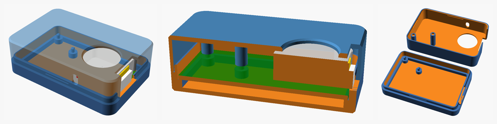

# 3D-printed case for the BF-018A antenna board with an ATOM Lite

A two-part snap-fit case for the BF-018A JJY antenna PCB with an M5Stack ATOM Lite plugged into its headers. No screws, no supports, no glue: the PCB drops onto two locating pegs in the base, and the lid snaps over the base and holds by friction.



| File | What it is |
|---|---|
| `BF-018A_case_base.stl` | Base tray. Print as is (floor on the bed). |
| `BF-018A_case_lid.stl` | Lid. Already turned over so its top face is on the bed. Print as is. |
| `BF-018A_case.scad` | Parametric OpenSCAD source. Every dimension and clearance is a named variable at the top. |
| `preview.png` | Rendering: assembled case, cut through the ATOM, and the two parts in print orientation. |

Outside size: 63.7 x 42.1 x 20.8 mm.

## Where the dimensions come from

Nothing was estimated from photos. The board geometry was read from the KiCad Gerber and drill files in `../PCBV01L02/gerber/JLCPCB`, and the ATOM Lite geometry from M5Stack's official dimension drawing and datasheet.

| Item | Value | Source |
|---|---|---|
| PCB outline | 58.42 x 36.83 mm, corner radius 2.54 mm | `Edge_Cuts` Gerber (one board of the 2-up panel) |
| PCB thickness | 1.6 mm assumed (JLCPCB default) | not in the files, see notes |
| Mounting holes | 2 x 2.5 mm non-plated: 3.095/3.175 mm and 18.335/9.906 mm from the top-left corner | `NPTH.drl` |
| ATOM outline on the PCB | 24 x 24 mm, centred 45.64 mm from the left edge and 24.13 mm from the top edge, i.e. 0.78 mm from the right edge and 0.70 mm from the bottom edge | `F_SilkS` Gerber |
| Header pads | 5 pins at y = 16.51 mm, 4 pins at y = 31.75 mm, 2.54 mm pitch | `PTH.drl` |
| 100 uF capacitor | 6.3 mm dia, 7.7 mm tall, at 53.9/5.6 mm | `bf-018a_panel2-top-pos.csv` and BOM footprint |
| ATOM Lite body | 24.0 x 24.0 x 9.5 mm | M5Stack datasheet |
| ATOM pin rows | 7.62 mm either side of centre, matches the PCB pads exactly | M5Stack dimension drawing |
| USB-C port | centred on the right face, 7.3 mm above the ATOM's bottom face | M5Stack dimension drawing |
| Grove (HY2.0-4P) socket | under the USB-C, flush with the ATOM's bottom face, housing protrudes past the body | M5Stack drawing and product photos |
| Reset button | south face of the ATOM, 7.3 mm from its west edge, about 5.5 mm above the bottom face | M5Stack drawing and photos |

The ATOM does not sit on the PCB. Its female sockets bottom out on the 2.54 mm plastic of the male headers, so its bottom face is 2.54 mm above the PCB and its top face 12.04 mm above the PCB. The lid underside is 1.0 mm above that.

## How it fits together

* The PCB rests on a 1.5 mm perimeter ledge and on two standoffs, 3.0 mm above the floor, so the header solder tails have room. Two 2.2 mm pegs go through the PCB's 2.5 mm holes and fix its position. There is 0.25 mm clearance around the PCB edge.
* The ATOM's right face sits 0.78 mm inside the PCB edge, so the Grove housing and the USB-C plug reach through the east wall. That wall has a 16 mm wide opening from just under the ATOM to the top. A USB-C cable plug (overmould up to about 13 mm wide) and a Grove cable both fit. The wall stays closed below the ATOM.
* The lid has an 18 mm hole above the ATOM's button and LED. The ATOM's top face is 2.6 mm below the lid surface, so the button is easy to press and the LED is visible.
* A 3.5 x 6 mm slot in the south wall lines up with the ATOM's recessed reset button. Use a pin or a straightened paper clip.
* The lid skirt slides 3 mm down over a 1 mm lip on the base with 0.2 mm clearance. Three small ridges on the lip (north, south and west sides) click into grooves inside the skirt and hold the lid.
* Two bosses in the lid come down to 0.2 mm above the PCB and have a hole that receives the peg tips, so the PCB cannot lift once the lid is on. They also stop the lid from being fitted the wrong way round.

Assembly: drop the PCB (with the ATOM plugged in) onto the pegs, USB-C port toward the wall opening, then press the lid on until it clicks. To open, pull the lid off while pushing gently on the PCB through the button hole, or slide a fingernail into the seam.

## Printing on an Ender 3 class printer

| Setting | Value |
|---|---|
| Material | PLA or PETG |
| Nozzle / layer height | 0.4 mm / 0.2 mm (0.16 mm gives cleaner snap ridges) |
| Walls | 3 perimeters (1.2 mm), 4 top and bottom layers |
| Infill | 15 to 20 percent, any pattern |
| Supports | none |
| Orientation | both files print as supplied: base floor down, lid top down |
| Bed adhesion | a brim is not needed; use one if your bed adhesion is poor |

Print both parts at the same time or one after the other; neither takes much more than an hour at normal speeds.

If the lid is too tight or too loose, open `BF-018A_case.scad` in OpenSCAD, change `fit_clr` (0.20 mm per side by default) or `snap_p` (height of the snap ridges), and export the two parts again:

```bash
openscad -o BF-018A_case_base.stl -D 'part="base"' BF-018A_case.scad
```

```bash
openscad -o BF-018A_case_lid.stl -D 'part="lid_print"' BF-018A_case.scad
```

Setting `part` to `assembly`, `section_x` or `section_y` in the file shows the case with a mock PCB and ATOM inside for checking.

## Notes and assumptions

* PCB thickness is not recorded in the Gerber set, so 1.6 mm was assumed. A 1.0 or 1.2 mm board still fits; it just sits a little lower and has a little more vertical play.
* Case plastic does not affect the 40 kHz magnetic field of the antenna coil. Place the case as you would the bare board.
* The model was verified in software only: the two STLs are watertight, the PCB and ATOM mock-ups do not intersect either part, and the lid and base do not intersect when assembled. It has not yet been test-printed.
